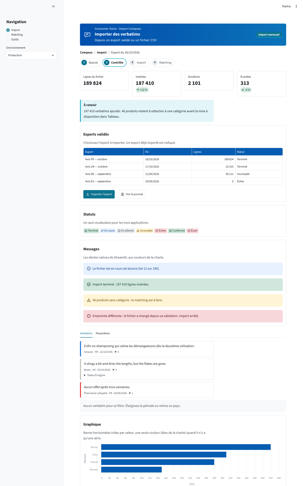
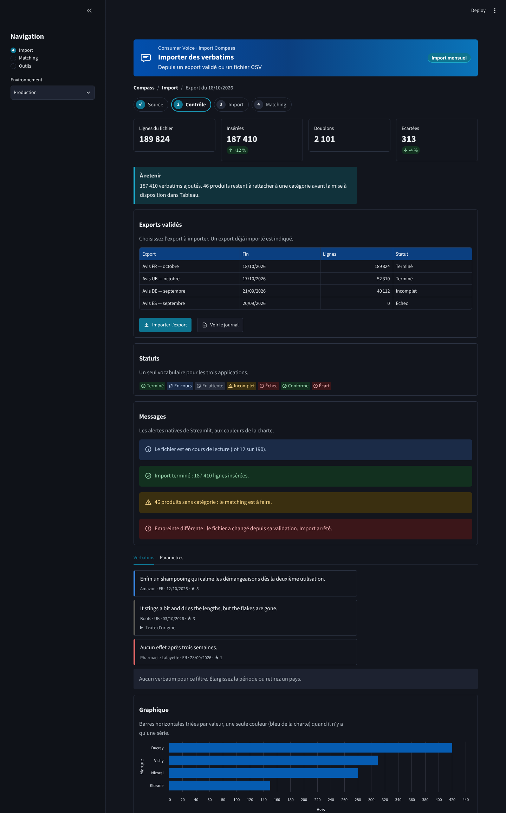

# Design guide — charte Consumer Voice (v1.0, 21/10/2026)

> À lire par Claude Code **avant toute modification d'interface** dans `api-explorer`, `mvp_verbatim_import`
> (`compass_import/`) et `rddt_connector`. Il fixe une seule apparence pour les trois applications Streamlit.
> Le sprint de migration propre à chaque dépôt est dans `docs/charte/SPRINT_charte.md`.

## 1. Référence et principe

- **Référence visuelle** : `verbatims_run/outils/rr_gabarit.html` (tableau de bord Ratings & Reviews) :
  charte « Medical Experts Mapping » (bleus et cyan), police **Atkinson Hyperlegible Next**, contrastes vérifiés,
  thème clair et sombre. Les trois applications doivent ressembler à ce gabarit.
- **Natif d'abord.** Streamlit 1.66 règle presque toute la charte dans `.streamlit/config.toml` : police, couleurs,
  rayons, alertes, badges, en-têtes de tableaux, clair et sombre. On utilise donc les éléments natifs
  (`st.button`, `st.metric`, `st.dataframe`, `st.info`, `st.tabs`, `st.form`…), qui prennent la charte
  automatiquement.
- **CSS minimal.** Le CSS ne sert qu'aux quatre composants que Streamlit n'a pas : bandeau, encadré « à retenir »,
  étapes, carte de verbatim (plus fil d'Ariane et état vide). Il ne vise que des classes `.cv-*`.
  **Ne jamais écrire de CSS sur les éléments internes de Streamlit** (`[data-testid=…]`, `.st-emotion-…`,
  `.stApp`, `.block-container`) : c'est ce qui casse à chaque mise à jour de Streamlit
  (cf. le correctif « data editor / dropdowns » de Compass v2.1). Seule exception, documentée dans
  `charte.css` : les chiffres des métriques en chasse fixe.



## 2. Le kit (identique dans les trois dépôts)

| Fichier | Rôle |
|---|---|
| `.streamlit/config.toml` | Thème Streamlit : police, couleurs clair / sombre, rayons, tableaux, graphiques |
| `charte/jetons.py` | Source unique des couleurs (mêmes valeurs que `config.toml`, vérifié par test) |
| `charte/charte.css` | Styles des composants `.cv-*` uniquement |
| `charte/composants.py` | `appliquer_charte`, `bandeau`, `fil_ariane`, `section`, `encadre_cle`, `etapes`, `carte_verbatim`, `vide`, `badge_statut`, `libelle_statut` |
| `charte_demo.py` | Page de démonstration : `streamlit run charte_demo.py` |
| `tests/test_charte.py` | Thème = jetons, contrastes WCAG AA, échappement du texte, chaque page applique la charte |

Règles :
- **Ne jamais modifier le kit dans une seule application.** On le modifie à un endroit, on incrémente
  `charte.VERSION`, puis on recopie les mêmes fichiers dans les trois dépôts.
- `requirements.txt` : `streamlit>=1.66` (sections `[theme.light]` / `[theme.dark]`, en-têtes de tableaux,
  `st.context.theme`, conteneurs horizontaux).
- `.streamlit/config.toml` se place à la **racine du dépôt**, même si le fichier principal est dans un sous-dossier
  (cas de Compass : `compass_import/Home.py`). Sur Streamlit Community Cloud, le dossier de travail est toujours la
  racine du dépôt et le fichier de configuration doit y rester
  ([documentation Streamlit](https://docs.streamlit.io/deploy/streamlit-community-cloud/deploy-your-app/file-organization)).
  Le dossier `charte/`, lui, va à côté du code qui l'importe. Vérification après déploiement : la police change
  aussitôt ; sinon, le fichier n'est pas lu.

## 3. Structure de toute page

```python
import streamlit as st
from auth import exiger_mot_de_passe
from charte import appliquer_charte, bandeau, section

st.set_page_config(page_title="Import — Compass", page_icon=":material/upload:", layout="wide")
exiger_mot_de_passe()          # 1. rien ne s'affiche sans mot de passe
appliquer_charte()             # 2. styles des composants, selon le thème clair ou sombre actif
bandeau("Consumer Voice · Import Compass", "Importer des verbatims",
        sous_titre="Depuis un export validé ou un fichier CSV")   # 3. remplace st.title()

with section("Exports validés", "Choisissez l'export à importer."):   # 4. contenu en sections
    st.dataframe(df, hide_index=True)
```

- Un seul `bandeau` par page, en premier. **Plus de `st.title()`.**
- `layout="wide"` partout. `page_icon` : une icône Material (`:material/nom:`), jamais un emoji.
- Le nom d'application du bandeau suit le modèle « Consumer Voice · … » :

| Dépôt | Nom dans le bandeau |
|---|---|
| `api-explorer` | `Consumer Voice · Collecte Semantiweb` |
| `rddt_connector` | `Consumer Voice · Collecte Reddit` |
| `mvp_verbatim_import` | `Consumer Voice · Import Compass` |

- Le thème clair / sombre se choisit dans le menu de Streamlit (⋮ → Settings → Theme). Le thème par défaut est
  celui du système. **Pas de bouton maison** pour changer de thème.

## 4. Jetons

Couleurs (thème clair ; le sombre est dans `jetons.py` et `config.toml`) :

| Jeton | Valeur | Usage |
|---|---|---|
| `brand-deep` → `brand-mid` | `#024fad` → `#0a74b9` | Dégradé du bandeau |
| `brand` | `#065cb1` | En-têtes de tableaux, série unique d'un graphique |
| `accent-ink` | `#0e7490` | **Action principale** (bouton `type="primary"`), onglet actif, étape en cours |
| `accent` | `#1ca9c9` | Liserés et accents **seulement** : jamais sous du texte blanc (contraste < 3:1) |
| `accent-soft` | `#e3f5f9` | Fond de l'encadré « à retenir » |
| `bench` | `#5c636a` | Références, éléments de comparaison |
| `ink` / `ink-2` / `ink-3` | `#212529` / `#495057` / `#6c757d` | Texte / libellés / méta |
| `line` / `field` | `#dee2e6` / `#868e96` | Bordures / bordures de champs |
| `page` / `panel` | `#ffffff` / `#f8f9fa` | Fond / champs et barre latérale |
| `pos` / `mix` / `neg` | `#2a78d6` / `#c4c2ba` / `#e34948` | Sentiment positif / neutre / négatif |
| `above` / `below` | `#198754` / `#a8421c` | Au-dessus / en dessous d'une référence |

- **Aucune couleur en dur dans le code Python**, sauf le bleu `#065cb1` d'un graphique à série unique. Toute autre
  couleur passe par un élément natif ou un composant du kit.
- Police : Atkinson Hyperlegible Next (400, 500, 700, 800), chargée par le thème. Titres en 700.
- Tailles : bandeau 1,3 rem ; `st.header` (titre de section) 1,15 rem ; `st.subheader` 1,05 rem ; texte 16 px.
- Rayons : 6 px (cartes, tableaux), 4 px (boutons, champs).

## 5. Quel composant pour quel besoin

| Besoin | Utiliser | Ne pas utiliser |
|---|---|---|
| Titre de page | `bandeau(appli, page, sous_titre=, etiquette=)` | `st.title`, HTML maison |
| Où suis-je | `fil_ariane([...])` (pages profondes uniquement) | — |
| Parcours en étapes | `etapes([...], courante=i)` | barre de progression détournée |
| Bloc de contenu | `with section(titre, intro):` (conteneur bordé natif + `st.header`) | `card_start` / `card_end` en HTML |
| Chiffres clés | `st.columns` + `st.metric(..., border=True)` ; **tous** avec un delta, ou aucun | cartes HTML |
| Message à retenir | `encadre_cle(texte, titre="À retenir")` | `st.info` |
| Information / succès / attention / erreur | `st.info` / `st.success` / `st.warning` / `st.error`, avec `icon=":material/…:"` | HTML maison |
| Statut (export, import, acquisition) | `st.markdown(badge_statut(statut))` ; dans un tableau : `libelle_statut(statut)` | texte technique brut (`COMPLETED`, `running`) |
| Tableau | `st.dataframe(..., hide_index=True)` + `column_config` (nombres, dates, liens) | tableaux HTML, `st.table` pour plus de 10 lignes |
| Choix exclusif court (2 à 4 options) | `st.segmented_control` | `st.radio` horizontal |
| Action principale | `st.button(..., type="primary")` : **une seule par section** | plusieurs boutons primaires côte à côte |
| Boutons groupés | `with st.container(horizontal=True):` | `st.columns` (tronque les libellés) |
| Progression | `st.progress(valeur, text=...)` | — |
| Verbatim cité | `carte_verbatim(texte, meta=, sentiment=, detail=)` | `st.write` du texte brut |
| Rien à afficher | `vide("Aucun …. Faites ….")` | message vide ou tableau vide |
| Navigation entre pages | barre latérale (`pages/` ou `st.navigation`), icônes Material | emojis dans les libellés |

Les badges natifs (`:green-badge[…]`) s'affichent dans `st.markdown`, pas dans `st.dataframe` : dans un tableau,
utiliser `libelle_statut()`. Le vocabulaire des statuts est commun aux trois applis (`charte.STATUTS`) :
Terminé, En cours, En attente, En pause, Incomplet, À vérifier, Échec, Écart, Conforme… Un nouveau statut s'ajoute
dans le kit, pas dans une seule appli.

## 6. Graphiques

- Barres **horizontales**, triées par valeur décroissante, quand les catégories ont des noms
  (`st.bar_chart(..., horizontal=True, sort="-colonne")`).
- Une seule série : une seule couleur, `#065cb1`. Plusieurs séries : couleurs du thème (`chartCategoricalColors`),
  sans les redéfinir.
- Sentiment : toujours `pos` / `mix` / `neg` (bleu, gris, rouge), dans cet ordre, comme le gabarit.
- Titre de section = la conclusion du graphique (« Ducray concentre 36 % des avis »), pas « Graphique ».

## 7. Rédaction de l'interface

- Français, phrases courtes, majuscule au premier mot seulement (« Exports validés », pas « Exports Validés »).
- Boutons : un verbe à l'infinitif + l'objet (« Importer l'export », « Lancer la collecte »), pas « OK » ou « Valider ».
- Nombres au format français (`189 824`, `12,5 %`), dates `JJ/MM/AAAA`. Dans `st.dataframe`,
  `NumberColumn(format="localized")` et `DateColumn(format="DD/MM/YYYY")`.
- Erreurs : ce qui s'est passé, puis quoi faire (« Empreinte différente : le fichier a changé depuis sa validation.
  Relancez la validation de l'export. »). Jamais de trace Python ni de secret à l'écran.
- Pas d'emoji dans les titres, menus, boutons ou messages : icônes Material uniquement.
- Pas de jargon technique visible quand un mot simple existe (« mentions conservées », pas « raw_mentions »).

## 8. Accessibilité (testé par `tests/test_charte.py`)

- Contraste ≥ 4,5:1 pour tout texte, en clair et en sombre (vérifié pour chaque paire de jetons utilisée).
- Le sens n'est jamais porté par la couleur seule : les badges ont une icône et un mot ; les verbatims, un liseré
  **et** une ligne de méta.
- Tout texte venant des données est échappé (les composants du kit le font ; ne jamais passer de données à
  `unsafe_allow_html=True` en dehors du kit).
- Libellés de champs toujours visibles (`label_visibility="collapsed"` seulement si un titre visible les remplace).

## 9. À éviter

- CSS sur les éléments internes de Streamlit ; `!important` ; fichiers CSS propres à une appli.
- `st.markdown(..., unsafe_allow_html=True)` pour un besoin couvert par un élément natif ou par le kit.
- Thème injecté par CSS ou bouton clair / sombre maison (le thème est dans `config.toml`).
- Couleurs en dur, polices chargées par `@import`, composants dans des iframes (`components.html`).
- Modifier le kit dans une seule application.

## 10. Vérifier une page

1. `pytest tests/test_charte.py` : vert (compléter `PAGES` et `MODULES` avec les fichiers de l'appli).
2. Ouvrir la page en clair puis en sombre, et en largeur 400 px (fenêtre étroite) : rien ne déborde.
3. Comparer à `charte_demo.py` et aux aperçus `apercus/demo_clair.png` / `demo_sombre.png`.



Note sur les aperçus : ils ont été pris dans un environnement sans accès à Google Fonts, avec la police de
remplacement. En production, Atkinson Hyperlegible Next est chargée par le thème.
